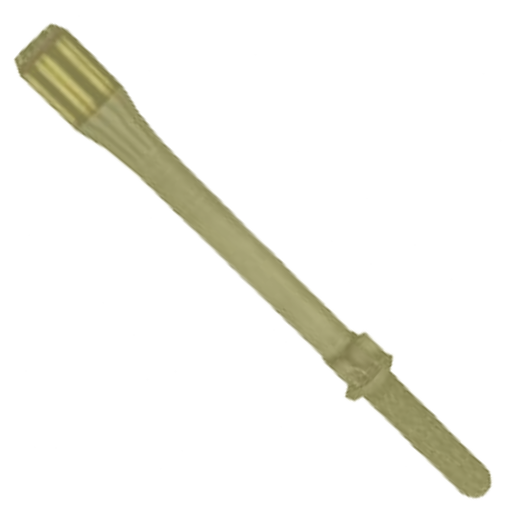

# Golden Stunstick



A Source engine modding workbench in a single Windows EXE:

- **Animator** – frame-by-frame / pose-by-pose animation of any QC's skeleton, with an
  automatic "easy rig" (IK for arms and legs), keyframe easing, smoothing and crossfades,
  saved to your session and exported as **SMD** or **DMX** (both verified to compile with studiomdl).
- **Model Viewer** – an HLMV++-style viewer for every model in the game your session mounts,
  with filters by name / folder / VPK, sequences and blends, bodygroups, skins, LODs, TF2 paints,
  flexes, bones, attachments, hitboxes, physics, bonemerge and a material/VPK report.
- **Compiler & Decompiler** – a Crowbar-style front end for `studiomdl.exe` with QC pre-checks,
  short error summaries, suggested fixes and `compileerror_<date>.txt` logs, plus a decompiler that
  **verifies its own output** by recompiling it and comparing the result with the original model.

Everything the program needs is built into `GoldenStunstick.exe` (icon, fonts, shaders, the C runtime).
The only thing created at runtime is the `goldenstunstick_files` folder next to the EXE.

---

## Building the EXE

### Requirements

- Windows 10/11 x64
- Rust **1.100.0** or newer (`rustc 1.100.0 (0ef1bc386 2026-11-09)` was used)
  - Install with [rustup](https://rustup.rs/) and the MSVC toolchain (`stable-x86_64-pc-windows-msvc`).
  - The MSVC toolchain needs the *Visual Studio Build Tools* ("Desktop development with C++" workload).
- An internet connection the first time (Cargo downloads the dependencies).

### Build

```powershell
rustup toolchain install 1.100.0
```

```powershell
cargo build --release
```

The finished program is:

```
target\release\GoldenStunstick.exe
```

Copy that one file anywhere you like and run it. On first start it creates
`goldenstunstick_files\` next to itself.

What makes it a single self-contained EXE:

| Piece | How |
|---|---|
| Window / taskbar icon | `assets/Stunstick_Icon.png` is compiled in with `include_bytes!` |
| File icon in Explorer | `build.rs` turns the PNG into a multi-size `.ico` and embeds it with `winresource` |
| C runtime | `.cargo/config.toml` links it statically (`+crt-static`), no VC++ redistributable needed |
| Console window | hidden in release builds (`windows_subsystem = "windows"`) |
| Fonts, shaders | built into the binary (egui default fonts, GLSL strings in `src/render.rs`) |

### Tests

```powershell
cargo test
```

Unit tests cover the file formats, the animation document, easing, IK and exporters. Some
integration tests use a real Team Fortress 2 install (default Steam path, or set `GS_TF2_DIR`)
and are skipped automatically when it isn't there. The slow ones that run studiomdl are opt-in:

```powershell
cargo test --test roundtrip -- --ignored --nocapture
```

```powershell
cargo test --test animator_export -- --ignored --nocapture
```

`roundtrip` decompiles real TF2 models, recompiles them with TF2's studiomdl and compares
everything (see [docs/CompilerDecompiler.md](docs/CompilerDecompiler.md)). Pick models with
`$env:GS_RT_MODELS = "models/player/heavy_animations.mdl"`.

---

## Using it

1. **Files ▸ New Session** – give the session a name, pick the game's `gameinfo.txt` and,
   optionally, `studiomdl.exe`. The tabs stay hidden until a session is open.
2. **Files ▸ Open Session** – lists every folder in `goldenstunstick_files\sessions\`.
3. Pick a tab: **Animator**, **Model Viewer** or **Compiler & Decompiler**.
4. **Settings ▸ Theme** – border / background / panel / text / accent colours, background image,
   background blur, opacity, rounding and UI scale.

**Is studiomdl.exe needed?** Only for compiling (and for the decompiler's optional
recompile-and-compare verification). Viewing, animating and decompiling work without it.
It usually lives in `<game>\bin\studiomdl.exe` or `<game>\bin\x64\studiomdl.exe`;
New Session fills it in automatically when it can find it.

### Command line (optional)

| Option | Effect |
|---|---|
| `--session <name>` | open a session from `goldenstunstick_files\sessions` |
| `--tab animator\|viewer\|compiler` | select a tab |
| `--model <models/...mdl>` | open a model from the mounted game in the Model Viewer |
| `--seq <name>` | sequence to play for `--model` |
| `--qc <file.qc>` | open a QC in the Animator (`--easy-rig` also builds the IK rig) |

---

## Files on disk

```
GoldenStunstick.exe
goldenstunstick_files\
├─ settings.txt                      theme settings
└─ sessions\
   └─ <session name>\
      ├─ session_settings.txt        gameinfo = ... / studiomdl = ...
      ├─ animations\                 Animator saves (<qc>_animation_N.txt)
      ├─ logs\                       compileerror_MMDDYYYY.txt
      ├─ decompiled\                 default output for "decompile from game"
      └─ screenshots\                Model Viewer screenshots
```

`goldenstunstick_files` is created once at startup and re-created automatically if it is deleted
while the program runs (it is checked every few seconds and before every write).

---

## Documentation

- [Sessions, settings & files](docs/Sessions.md)
- [Animator](docs/Animator.md)
- [Model Viewer](docs/ModelViewer.md)
- [Compiler & Decompiler](docs/CompilerDecompiler.md)
- [File formats & internals](docs/Internals.md)

## Project layout

```
src/
  main.rs            window setup, embedded icon, command line
  app/               main window, sessions, theme, goldenstunstick_files
  tabs/              animator.rs, model_viewer.rs, compiler.rs
  formats/           vpk, keyvalues, vtf, mdl (+vvd/vtx + animation decoder), phy, smd, qc
  gamefs.rs          gameinfo.txt search paths (first match wins)
  scene.rs           loaded model: posing, blending, flexes, skinning, materials
  render.rs          OpenGL renderer + orbit camera
  decompile.rs       MDL -> QC/SMD/VTA/VRD
  verify.rs          decompile self-check and recompile comparison
  compile.rs         studiomdl runner, error analysis, error logs
  anim.rs            Animator rig, animation document, IK, TXT/SMD/DMX
build.rs             PNG -> ICO, embeds the EXE icon
tests/               integration tests against a real TF2 install
```

## License

CC0 1.0 Universal – see [LICENSE](LICENSE).
